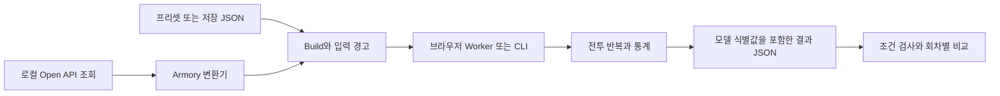

# 구조와 설계

## 데이터 흐름

## 전투 모델

엔진은 현재 시각, 버프, 스킬 사용 가능 시각, 손패, 카드 게이지, 대상 스택을 관리합니다. 로테이션 정책이 다음 행동을 고르면 시전·타격·지연 효과와 카드 사용이 상태를 바꿉니다. 직접 피해, 스택트 피해, 지속 피해를 구분해 집계합니다.

게임 데이터와 계수 후보는 `data/*.json`에 있습니다. 변환기는 지원하지 않는 입력을 조용히 확정하지 않고 경고로 남깁니다. 가정과 미지원 동작은 [현재 한계](LIMITATIONS.md)에 정리합니다.

## 난수와 비교

기존 난수 방식은 과거 결과 재현을 위해 유지합니다. `partitioned-v1`은 치명·카드·추가 발동 등의 판정별 난수 흐름을 나눠, 한 종류의 판정이 추가되었다고 무관한 종류까지 일괄적으로 밀리지 않도록 합니다.

각 회차의 두 결과를 직접 빼서 차이의 평균과 표준오차를 구합니다. 공통 seed는 모든 카드 결과를 같게 만들지 않으며, 추가 시전이나 손패 변화 같은 실제 모델 차이는 유지합니다. 세팅에 따라 분산이 더 커질 수도 있습니다.

## 재현성과 실행 경계

- 결과에는 전체 입력, 경고, 시간, 반복 수, seed, 난수 방식, 모델 식별값, 회차 표본이 함께 저장됩니다.
- 계산에 영향을 주는 소스와 게임 데이터의 SHA256으로 모델을 식별합니다.
- 다른 모델이나 실행 조건의 결과는 호환성 검사 없이 수치 비교하지 않습니다.
- 화면과 저장 입력 실행 CLI는 계산을 별도 Worker로 분리하고 30초 제한을 둡니다.
- 저장 입력 실행은 최대 900초·20,000회이며 유효하지 않은 수치나 실패를 완료 결과로 저장하지 않습니다.

## 저장소 구성

| 경로 | 역할 |
|---|---|
| `src/engine/` | 전투 상태, 피해, 카드, 입력 변환 |
| `src/main.ts`, `src/worker.ts` | 화면과 계산 Worker |
| `src/compare.ts`, `src/resultComparison.ts` | 입력·결과 검증과 비교 |
| `data/*.json` | 계수와 효과의 모델 입력 |
| `scripts/` | 저장 입력 실행·재현·비교, 로컬 조회 |
| `tests/fixtures/` | 비식별 처리한 회귀 테스트 자료 |
| `docs/`, `docs/wiki/` | 사용·설계·검증 문서와 Wiki 원본 |

외부 입력을 화면에 표시할 때는 텍스트로 출력합니다. API 키는 Vite 개발 서버에서만 읽으며, 정적 번들에 삽입하지 않습니다.
